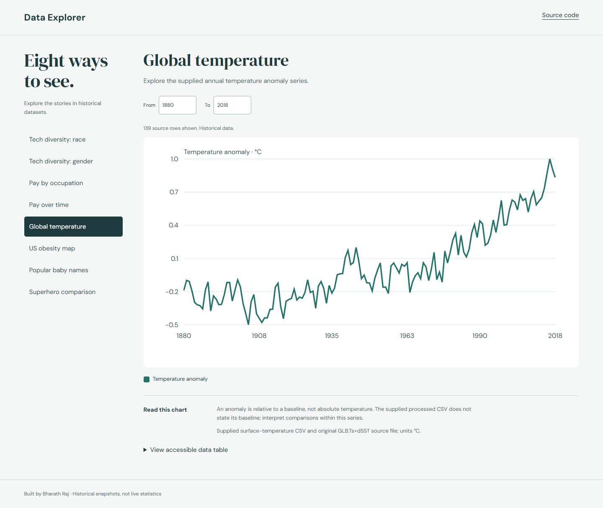

# Data Explorer

Historical datasets are easier to understand when the chart opens with an example, explains its units and gives readers access to the values underneath.



## Demo

[Open the live demo](https://bharath-raj-official.github.io/data-explorer/). Local setup is also available below.

## What it does

- All eight supplied dataset groups: workforce race/gender, occupation pay, pay over time, temperature, US obesity, baby names and superhero attributes.
- Default temperature-anomaly chart, organized navigation and chart-specific company/year/character filters.
- Native SVG visualizations, legends, source/date notes, interpretations and accessible HTML tables.
- CSV support for quoted commas/newlines, useful loading/error/empty-range states and stale-request protection.

## Run locally

```sh
python -m http.server 8000 --bind 127.0.0.1
```

Open http://127.0.0.1:8000/ in a modern browser. Run the command inside this repository. Do not open `index.html` directly from disk: local datasets/model assets use HTTP. Python 3 is only a local static server; no application build is required.

## Controls

Choose a dataset from the navigation. Adjust the controls shown for that chart. View accessible data table exposes the source values; tables are capped at 500 rows with a visible note. Wide charts scroll within their chart container on phones.

## Architecture and decisions

`csv.js` parses the supplied local CSVs. `explorer.js` manages dataset selection, cached rows, filters, SVG construction and text-only table rendering. SVG viewBoxes scale without recreating application state. Bar charts start at zero, superhero axes share 0–100 and baby-name bubble area is proportional to count. Original p5 implementations are retained as reference source but are not loaded by the new interface.

## Limitations

These are historical extracts, not live datasets. Source workbooks do not establish every methodology or observation date. The processed obesity header says Average BMI while its original column says Obesity; the view explicitly reports source values without unsupported BMI categories. Temperature baseline is not specified in the supplied processed CSV. Binary workforce categories reflect the source and do not describe every gender identity.

## Validation

All eight charts render in Edge; phone overflow was repaired. Quoted CSV fixtures pass. The original dataset files are preserved; chart interpretation does not silently change their units or dates.

## Third-party attribution

Original source files and notes remain under `data/`. US SVG map © Simplemaps, with the embedded licensing notice retained. Dataset provenance is displayed per chart. Original p5 dependencies retain their notices.

